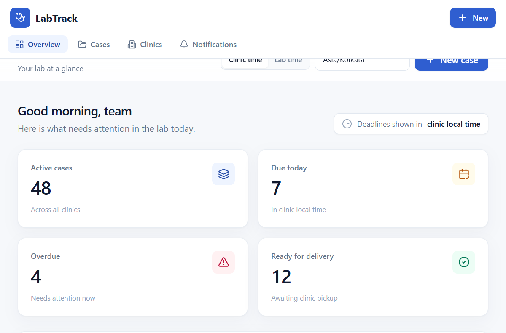
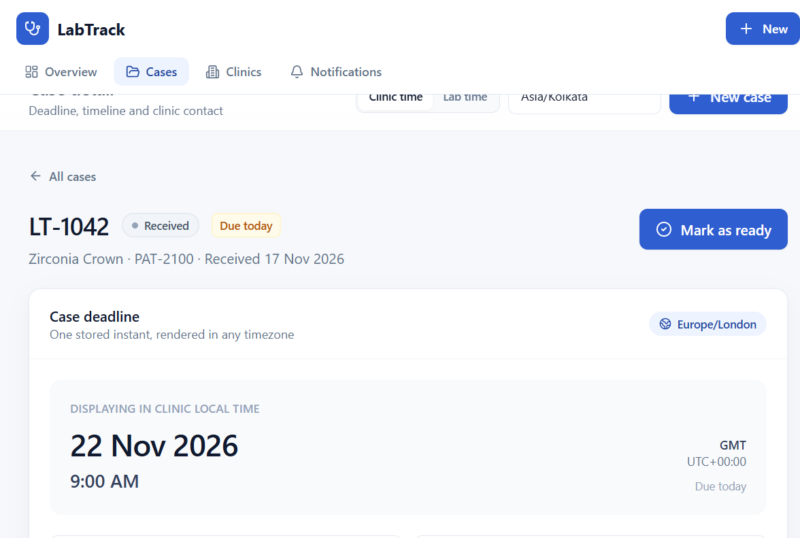
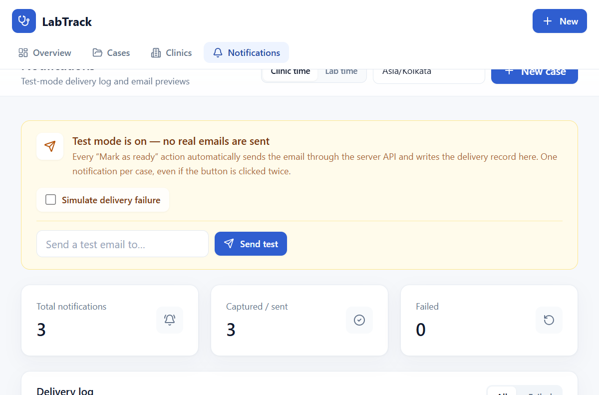
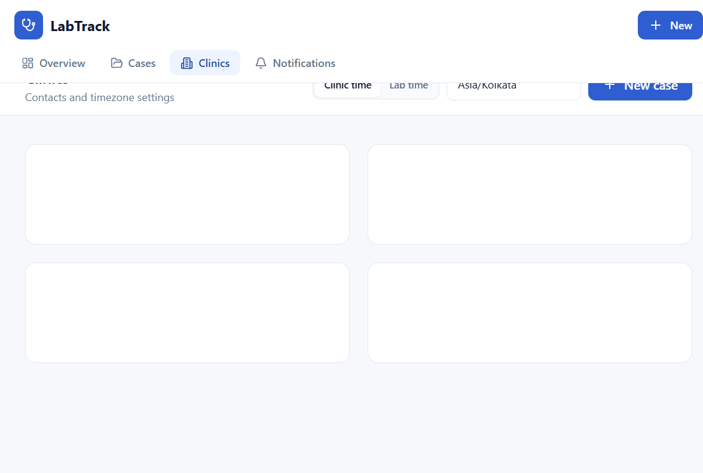

# LabTrack

**Dental lab operations dashboard** — a small, demo-ready SaaS app for a dental lab tracking cases sent by clinics.

> **Live demo:** https://labtrack-chiron.vercel.app
> **Public repo:** https://github.com/Adars2005/labtrack-chiron
> **Loom walkthrough:** `TODO — add Loom URL before submitting`

Built as the take-home for Chiron Labs' Forward Deployed Engineer role. The three client asks were: fix international due dates, notify clinics when a case is ready, and simplify a cluttered dashboard.

---

## Screenshots

| Overview | Cases table |
|---|---|
|  |  |

| Case detail — timezone proof | Notification outbox |
|---|---|
|  |  |



---

## Tech stack

| Layer | Choice |
|---|---|
| Framework | Next.js 15 (App Router), React 19, TypeScript |
| Styling | Tailwind CSS, custom shadcn-style primitives, Lucide icons |
| Date/time | **Luxon** (IANA zones, DST-aware) |
| Persistence | Browser `localStorage` demo store with a seeded repository layer |
| Email | Test-mode outbox; Resend-ready env vars for a live adapter |
| Deployment | Vercel |
| Tests | Vitest |

**Why browser persistence?** The brief explicitly allows local demo data with persistent browser storage when a hosted database isn't available, and says not to sacrifice the product for backend setup. Vercel's filesystem is ephemeral, so a JSON file would not survive; `localStorage` keeps every button in the demo genuinely functional. The store is isolated in `lib/store.tsx`, so replacing it with Supabase is a repository swap, not a rewrite.

---

## Features

### Overview
- Active cases, due today, overdue, and ready-for-delivery metrics.
- "Needs attention" queue: overdue → due today → ready.
- Upcoming deadlines and recent activity feed.
- Deadline view toggle applies globally.

### Cases
- Search by case reference, clinic, treatment or de-identified patient reference.
- Filter by status, clinic, and quick buckets (overdue / due today / ready).
- Sort by due date, status or most recently received.
- Status and urgency badges; every row opens the case detail view.

### Case detail
- Full case information, clinic contact and activity timeline.
- **Side-by-side deadline proof**: clinic local view and lab local view of the same instant, with offsets and the underlying stored UTC ISO string.
- Clinic-local date/time entered, clinic timezone, and computed UTC instant all shown explicitly.
- **Mark as ready** action: status changes, timeline updates and a clinic email is sent automatically.
- Status can be changed inline (Received / In progress / Ready / Completed) with an activity-timeline entry; choosing Ready triggers the clinic email.

### Clinics
- Clinic directory with country, IANA timezone, contact and configured notification email.
- Live local clock per clinic — a quick visual check that each clinic really is on its own timezone.
- Add a clinic with any valid IANA zone (curated dropdown plus free-text validation).

### Notifications
- Test-mode banner and delivery log with status per message.
- Full email preview (to, subject, body, timestamp).
- Simulate delivery failure and retry, so the failure path is demonstrable.
- Idempotency: one `CASE_READY` notification per case.

---

## How timezone handling works

The original bug is a category error: a calendar deadline was treated as a generic timestamp and shifted into whatever timezone happened to be in scope. LabTrack separates **input**, **storage** and **display**:

1. **Input** — staff enter a date and a wall-clock time *for a chosen clinic* (e.g. `2026-11-25`, `17:00`, `Europe/London`).
2. **Storage** — `deadlineToUtc()` interprets that wall time in the clinic's IANA zone and produces one canonical UTC instant (`2026-11-25T17:00:00Z` for London in November, `2026-07-25T16:00:00Z` for London in July). Stored in `LabCase.deadlineUtc`.
3. **Display** — `displayDeadline(utc, zone)` renders that instant in any zone without mutating it. The header toggle switches between clinic local and lab local; the detail page shows both simultaneously with UTC offsets labelled.
4. **Urgency** — `dueInfo(utc, zone, now)` compares *calendar dates inside the display zone*, so "due today" cannot be caused by a millisecond boundary in another zone.

Rules enforced in code:
- No `new Date("YYYY-MM-DD")`, no `toISOString().slice(0, 10)`, no manual `±1 day` corrections, no `getTimezoneOffset()` math.
- Invalid IANA zones are rejected rather than silently defaulting.
- DST is delegated to Luxon.
- Device and server timezones are never consulted for deadline logic.

Verification: `npm test` runs 11 tests — 8 timezone regressions (London winter/summer, New York, Kolkata/Dubai offsets, invalid zones, date-only display, cross-zone calendar-day comparisons) plus 3 email-copy/idempotency checks.

---

## How email delivery works

```
Mark as ready
   → case status = Ready + timeline event
   → CASE_READY notification row created (status: Sending)
   → POST /api/notify fires AUTOMATICALLY (no manual send click)
        /api/notify → Resend API when NOTIFY_MODE=live + RESEND_API_KEY are set
        /api/notify → captured result in test mode (no credentials needed)
   → status becomes Sent / Sent (Simulation) / Failed
   → email preview + delivery log visible to lab staff
```

- **Automatic.** Sending is triggered by the server API on the ready transition; the client never asks the user to confirm a separate send.
- **Live mode:** set `NOTIFY_MODE=live` and `RESEND_API_KEY` in Vercel, optionally `NOTIFICATION_FROM_EMAIL`. The UI banner switches to "Live delivery is on". Resend's `onboarding@resend.dev` sender works for the account owner's address while testing.
- **Test mode:** with no key (the current deployment), the endpoint returns `Sent (Simulation)` so the whole flow still works end to end without credentials.
- **Idempotent.** One `CASE_READY` notification per case, so double-clicking never produces two emails.
- **Send test field** on the Notifications page posts a sample message through the same API, so live delivery can be verified with your own inbox before the demo. Seeded clinic addresses are fictional, so in live mode send to your own address (or a verified domain recipient) — Resend rejects unregistered test domains.
- **Failure-aware.** Provider errors are surfaced as `Failed` with the reason, and Retry re-posts to `/api/notify`; the status change is never rolled back because mail failed. The "simulate failure" switch exercises the same path without a provider.
- **Copy.** `buildReadyEmail()` in `lib/seed.ts` holds the template; `lib/store.tsx` injects the deadline in clinic local time before posting.

---

## Run locally

```bash
npm install
npm run dev
```

Open [http://localhost:3000](http://localhost:3000). Use **Reset demo data** in the sidebar to restore the seeded dataset at any time.

```bash
npm test        # timezone regression tests
npm run build   # production build
npm start       # serve the production build
```

Environment variables are optional for the demo; see `.env.example`.

---

## Deployment

Push to GitHub and import the repository in Vercel with the default Next.js settings. No environment variables are needed for demo mode.

---

## AI tools used and how

**OpenCode (Big Pickle agent)** was the AI coding tool used for this build, with the user-supplied written specification and UI direction as the input brief.

- Used to scaffold the Next.js project, generate the component and store implementations, draft the timezone regression tests, write the ticket/client/application documents, and review the production build.
- Used to reason about the timezone failure mode and to pressure-test idempotency and failure handling.
- No other AI coding services were used.
- All generated code was reviewed, type-checked (`next build`), tested (`vitest`) and exercised manually in a browser, including the mark-ready → outbox flow. Product decisions (what to ship, what to defer, what to ask the client) were made by me.

---

## Deliberate trade-offs / not shipped

| Not shipped | Why |
|---|---|
| WhatsApp / SMS | Needs a business provider, verified number and documented clinic opt-in. Email is what Maria approved "to start". |
| Supabase/Postgres | No credentials available; browser persistence keeps the demo fully functional. Isolated behind `lib/store.tsx`. |
| Live email sending | Recipients and copy need client approval; test mode is demo-safe. |
| Auth / multi-user roles | Out of scope for a 3–4 hour take-home; no real PHI is used. |
| Full design-system rewrite | "Cluttered" is ambiguous; shipped a small, reversible improvement and asked Maria what to change next. |

See [TICKETS.md](TICKETS.md) for the full product breakdown, acceptance criteria, client questions and assumptions.
